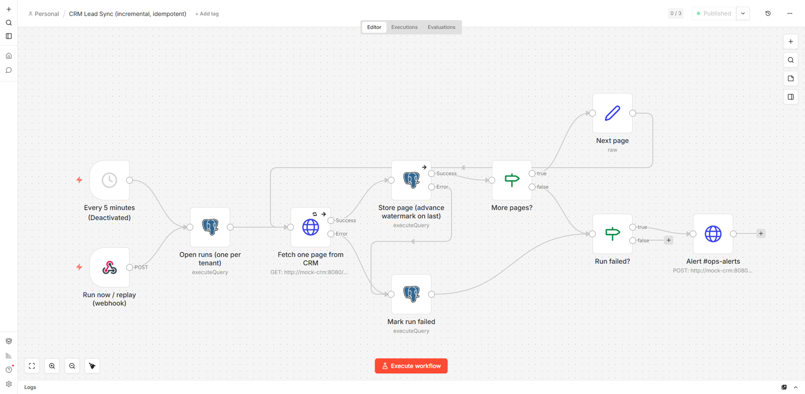
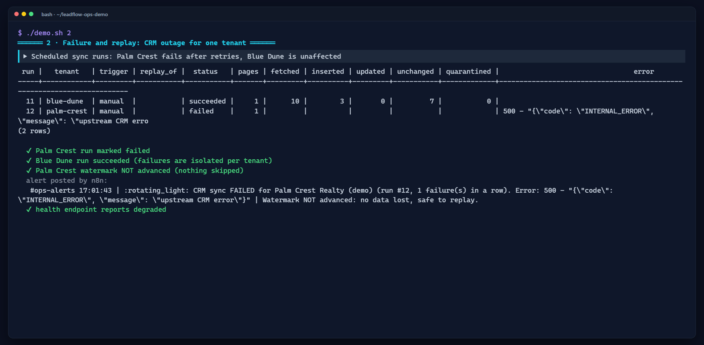
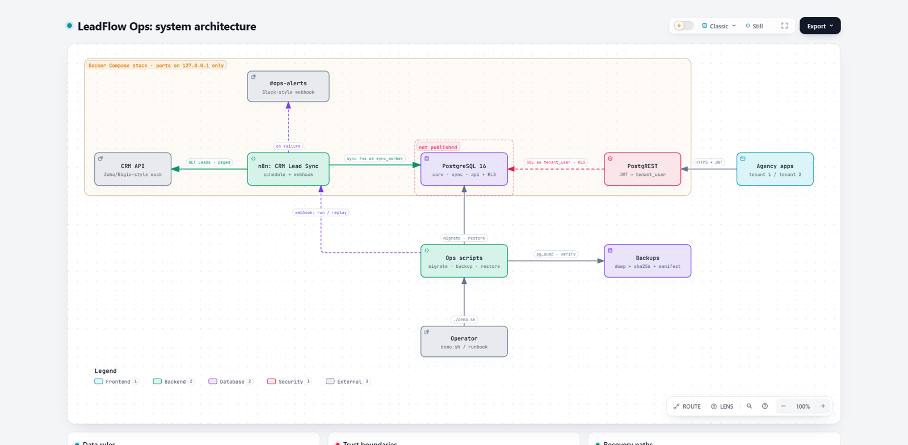
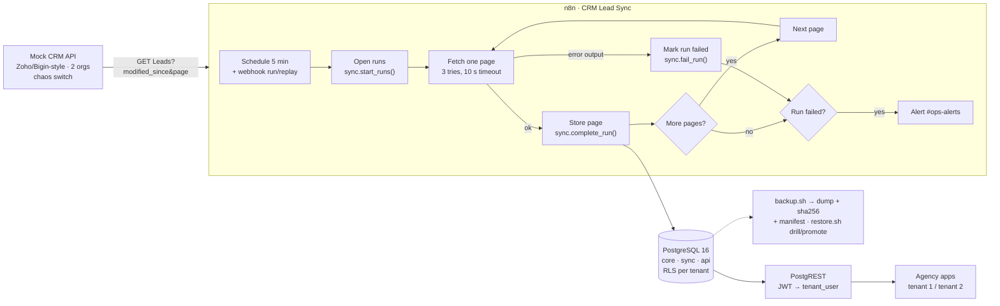

# LeadFlow Ops: CRM → n8n → PostgreSQL, built to fail safely

A self-contained replica of the kind of integration I build and run in production. A CRM (Zoho/Bigin-style API)
feeds a multi-tenant PostgreSQL database through an n8n workflow, for two fictional real-estate agencies.

The happy path is the easy part. This repo is about what happens when things go wrong:

- a CRM outage
- a malformed record
- one agency probing another agency's data
- an accidental delete
- a bad release

### ▶ Video walkthrough (6 min)

[](https://youtu.be/vkyFjgdyuwE)

| Sync run in n8n | Failure caught, alerted, nothing lost |
|---|---|
|  |  |

> **Clean-room build.** I wrote this from scratch for a hiring assessment. It contains no employer code, schema,
> or data. Every agency, lead, and phone number is generated and fictional.

---

## Contents

1. [What it proves](#what-it-proves)
2. [Architecture](#architecture)
3. [Quick start](#quick-start): macOS · Windows · Linux
4. [Commands](#commands)
5. [Design decisions](#design-decisions)
6. [Known limits and production additions](#known-limits-and-production-additions)
7. [Repository layout](#repository-layout)
8. [How the video was produced](#how-the-video-was-produced)

---

## What it proves

`./demo.sh all` runs five scenarios. Each one **asserts** its own outcome (`✔` / `✖`), so the run doubles as an
end-to-end test: **62 checks**.

| # | Scenario | What happens | What is asserted |
|---|---|---|---|
| 1 | **CRM sync** | Initial load of 210 leads. The next run fetches only the changes (8 new, 5 stage moves). A bulk import of 450 leads with the same timestamp is paged through in one run. A re-run writes nothing | Record-by-record reconciliation CRM ↔ database (id + version); zero duplicates |
| 2 | **Failure & replay** | One 429 is absorbed by retries, with no alert. A sustained 500 outage hits **one** agency: its run fails after 3 tries, the alert fires, and the watermark stays put, while the other agency syncs normally. A `replay` run, linked to the failed run, refetches the same window. A malformed record is quarantined with its reason | Run statuses; watermark unchanged; health `degraded` → `ok`; reconciliation |
| 3 | **Tenant isolation** | Through the API, agency 1 tries to read, filter, update and insert agency 2's rows. RLS answers `[]`, 0 rows, and `403`. No token or a forged token gets `401`. The n8n database account cannot read the leads table | HTTP codes; database unchanged |
| 4 | **Backup & restore** | Backup with dump, sha256, globals and a manifest. A restore drill into a scratch DB. Then an **accidental delete** of an agency's leads, followed by a promoted restore. The next sync refetches everything created after the backup | Live DB equals the manifest (counts, checksum, watermarks, RLS); reconciliation |
| 5 | **Release rollback** | Release 004 applies cleanly, with an automatic pre-deploy backup, but breaks the sync. The alert carries the real error, `SQLSTATE 42703: column "phone" … does not exist`. One command rolls it back, and a replay closes the gap | Schema version; runs succeed; reconciliation |

---

## Architecture



Interactive versions of the diagrams are in [`docs/architecture/`](docs/architecture/); download a file and open it
in a browser. Their sources (`docs/architecture/src/*.json`) are versioned with the code.

| Diagram | Answers |
|---|---|
| [System architecture](docs/images/architecture.png) | What runs where, who calls whom, and where the trust boundaries are |
| [Sync run](docs/images/sync-run.png) | How one run moves through pages, retries, and failure handling |
| [Database schema](docs/images/database-schema.png) | Which keys and constraints carry the idempotency and isolation guarantees |



| Service | Role | Port (localhost only) |
|---|---|---|
| `db` | PostgreSQL 16; not published, reachable only on the internal Docker network | none |
| `api` | PostgREST v12, JWT auth, exposes only schema `api` | 3001 |
| `n8n` | n8n 2.14.2; workflow and credentials imported from code at boot | 5678 |
| `mock-crm` | Zoho-style Leads API, chaos switch, and a Slack-style alert sink | 8089 |

---

## Quick start

### Requirements (all platforms)

| Tool | Why | Check |
|---|---|---|
| Docker with Compose v2 | Runs Postgres, PostgREST, n8n, and the mock CRM | `docker compose version` |
| bash | Runs the scripts (built into macOS and Linux; Git Bash on Windows) | `bash --version` |
| curl, openssl | Calls the APIs, generates secrets | `curl --version`, `openssl version` |
| Python 3 (standard library only) | JSON formatting and test JWTs | `python3 --version` or `python --version` |

About 2 GB of free disk space for the images. The first `setup` downloads them and takes a few minutes.

### macOS

1. **Install Docker Desktop** from <https://www.docker.com/products/docker-desktop/>. It supports both Apple Silicon
   and Intel. Start it and wait until it shows **Engine running**.
2. **Check Python 3.** It ships with the Xcode Command Line Tools. If `python3 --version` fails, run
   `xcode-select --install`.
3. **Open Terminal**, then clone and run:
   ```bash
   git clone https://github.com/FerasTamer/leadflow-ops-demo.git
   cd leadflow-ops-demo
   chmod +x demo.sh scripts/*.sh
   ./demo.sh setup
   ./demo.sh all
   ```

### Windows

1. **Install Docker Desktop** from <https://www.docker.com/products/docker-desktop/> with the **WSL 2** backend.
   Start it and wait until it shows **Engine running**.
2. **Install Git for Windows** from <https://git-scm.com/download/win>. It includes **Git Bash**, which runs the
   scripts. Use Git Bash, not PowerShell or CMD.
3. **Install Python 3** from <https://www.python.org/downloads/>, and tick **Add python.exe to PATH**. The Microsoft
   Store `python3` alias is detected and skipped automatically.
4. **Open Git Bash**, then clone and run:
   ```bash
   git clone https://github.com/FerasTamer/leadflow-ops-demo.git
   cd leadflow-ops-demo
   ./demo.sh setup
   ./demo.sh all
   ```
   > Clone with Git Bash so line endings stay LF (`.gitattributes` enforces it). The scripts already handle Git
   > Bash's path conversion.

### Linux

1. **Install Docker Engine and the Compose plugin.** Follow <https://docs.docker.com/engine/install/> for your
   distribution, then check with `docker compose version`. To run Docker without `sudo`, run
   `sudo usermod -aG docker $USER`, then log out and back in.
2. **Install the tools.** On Debian/Ubuntu: `sudo apt install -y git curl openssl python3`.
3. **Clone and run:**
   ```bash
   git clone https://github.com/FerasTamer/leadflow-ops-demo.git
   cd leadflow-ops-demo
   chmod +x demo.sh scripts/*.sh
   ./demo.sh setup
   ./demo.sh all
   ```

### What a successful run looks like

```
══════ Setup ══════
  ✔ PostgreSQL ready
  ✔ applied 001 (001_core.sql) … 003 (003_security.sql)
  ✔ n8n ready (workflow imported and published)
…
══════ 1 · CRM sync: initial load, incremental changes, idempotent re-run ══════
  ✔ Palm Crest Realty (demo): CRM 120 = warehouse 120 + quarantined 0, every id and version matches
…
══════ All five scenarios passed ══════
```

`setup` generates a git-ignored `.env` with random secrets. Nothing secret is committed.

### Troubleshooting

| Symptom | Fix |
|---|---|
| `missing required tools: …` | Install what it names, then run `./demo.sh setup` again |
| `Cannot connect to the Docker daemon` | Start Docker Desktop (or `sudo systemctl start docker`) and wait for it |
| `port is already allocated` (3001, 5678, 8089) | Stop whatever uses that port, or change the left side of `ports:` in `docker-compose.yml` |
| `Permission denied: ./demo.sh` (macOS/Linux) | `chmod +x demo.sh scripts/*.sh` |
| `bad interpreter: /bin/bash^M` | Line endings were converted to CRLF: `git config core.autocrlf false`, then clone again |
| A `✖` appears, or you want to start over | `./demo.sh reset && ./demo.sh setup`, then rerun the scenarios in order |

---

## Commands

| Command | What it does |
|---|---|
| `./demo.sh setup` | Generate `.env`, start the stack, apply migrations, import and publish the n8n workflow |
| `./demo.sh all [--pause]` | Setup plus all five scenarios; `--pause` waits for Enter before each step (good for presenting) |
| `./demo.sh 1` … `./demo.sh 5` | Run one scenario. Run them in order after `setup`, because each builds on the previous state |
| `./demo.sh status` | Schema version, lead counts, watermarks, recent runs, health |
| `./demo.sh sync` | Trigger one sync run through the n8n webhook |
| `./demo.sh reset` | Remove containers, volumes and backups (`.env` is kept) |
| `scripts/migrate.sh up \| apply <file> \| down \| status` | Versioned migrations with automatic backup and one-step rollback |
| `scripts/backup.sh [label]` | Backup: dump + sha256 + globals + manifest, keeps the newest `BACKUP_KEEP` |
| `scripts/restore.sh <name\|latest> [--promote]` | Verified restore into a scratch DB; `--promote` swaps it in as live |

While it runs:
- **n8n editor:** <http://localhost:5678>. Create a local owner account the first time, then open **CRM Lead Sync**
  and its **Executions** tab.
- **Alert channel:** `docker compose logs -f mock-crm`.

---

## Design decisions

- **The watermark moves only in the transaction that stores the data.** A run that fails anywhere leaves the
  watermark where it was, so a replay is always safe and never skips data.
- **Idempotent by key, monotonic by version.** Upserts key on `(tenant_id, crm_id)` and only overwrite with a newer
  `Modified_Time`. Retries, replays and out-of-order deliveries cannot duplicate or regress a record.
- **Overlapping window.** Each run fetches from the watermark minus 2 minutes, so records edited in the same second,
  or committed late with a slightly older timestamp, are refetched instead of missed. They count as `unchanged`.
- **Explicit page loop.** n8n fetches one page (200 records) at a time and loops while `more_records` is true. Each
  page is stored in its own transaction, and the watermark moves only after the last page. I avoided the HTTP
  node's built-in pagination on purpose: in n8n 2.14 it hands back a 429 or 500 response as if it were a normal
  page, which would hide an outage as an empty "successful" run. The scenarios caught this.
- **One run per tenant at a time.** A partial unique index (`status = 'running'`) enforces it in the database, not
  with check-then-insert. A run that never reports back is marked abandoned after 10 minutes.
- **Bad data is quarantined, not dropped.** Invalid records go to `sync.quarantine` with the reason and the raw
  payload. Reconciliation accounts for them explicitly.
- **The database records its own failures.** If storing fails, `complete_run()` rolls back its writes and marks the
  run failed with the real SQLSTATE. Both alert paths read the run's real status from the database, so a run that
  committed before n8n lost the response never raises a false alarm.
- **Failures are isolated per tenant.** Each agency has its own run, window and error path.
- **Least privilege.**
  - n8n connects as `sync_worker`, which can execute three `SECURITY DEFINER` functions and cannot read any table.
  - PostgREST switches to `tenant_user`, which `FORCE ROW LEVEL SECURITY` restricts to the `tenant_id` in its JWT.
  - The public health endpoint returns aggregates only.
  - Role passwords go to psql on stdin, never as command-line arguments.
  - Postgres is never published, and every port binds to `127.0.0.1`.
- **The CRM is the source of truth.** The API grants `insert`/`update` only so the demo can prove that RLS
  `WITH CHECK` blocks cross-tenant writes. In production, agency edits would go back to the CRM through n8n, and
  this API would be read-only.
- **Backups are only as good as their restore.** Every backup has a checksum and a manifest. A restore always goes
  to a scratch database first and must reproduce the manifest exactly before it can be promoted. The old database
  is kept for forensics.
- **Migrations are versioned, checksummed, and reversible.** Each migration runs in one transaction together with
  its bookkeeping row and ships with a `.down.sql`. A backup is taken automatically before every deploy and every
  rollback.

---

## Known limits and production additions

**Demo-mode choices**
- **The 5-minute Schedule node is disabled**, so the scenarios are deterministic. To enable it, set
  `"disabled": false` in the workflow, or toggle it in the editor.
- **Offset paging has a known race.** Zoho-style `page` numbers can skip a record if the CRM reorders results
  during a run. The record-by-record reconciliation detects that gap; in production it would run nightly and
  resync any differences.
- **Restore is verified on the same Postgres cluster.** To rebuild on a new server, replay `*.globals.sql` first
  (roles and grants), then reset the passwords from the secret store.

**What I would add on a real client server**
- **Real Bigin OAuth:** refresh-token rotation stored in n8n credentials.
- **Off-site backups:** schedule `backup.sh` with cron or a systemd timer, copy dumps to encrypted S3-compatible
  storage, and alert when no backup succeeds within 24 hours.
- **Monitoring:** point Uptime Kuma or Prometheus/Grafana at `/rpc/health` and n8n's `/healthz`. For larger volumes,
  run n8n on Postgres in queue mode.
- **Hardening:** TLS through nginx, firewall rules, and a secrets manager or `docker secret` in place of `.env`.

---

## Repository layout

```
demo.sh                           scenarios + setup / status / sync / reset
docker-compose.yml                db · api · n8n · mock-crm, all bound to 127.0.0.1
db/migrations/                    001 core · 002 sync engine · 003 security (each with .down.sql)
db/release-candidates/            004 faulty release used by the rollback scenario
n8n/workflows/crm-lead-sync.json  the workflow, imported and published at boot
n8n/bootstrap.sh                  renders credentials from env vars, imports, publishes, starts n8n
scripts/lib.sh                    shared helpers (portable across macOS, Linux, Git Bash)
scripts/migrate.sh                up | apply <file> | down | status
scripts/backup.sh                 dump + sha256 + globals + manifest + retention
scripts/restore.sh                verify → scratch restore → manifest check → optional promote
mock-crm/server.py                Zoho-style API, chaos switch, alert sink (Python standard library only)
tools/mint_jwt.py                 short-lived tenant JWTs for the isolation scenario
docs/architecture/                interactive diagrams (HTML) and their sources
docs/images/                      screenshots used in this README
video/script/                     narration script, one file per video segment
video/tools/                      the automated video pipeline (below)
```

---

## How the video was produced

The walkthrough video was produced automatically, not screen-recorded:

1. **Real run.** The five scenarios are run against a fresh stack, and each scenario's output is captured with
   its colours (`DEMO_COLOR=1`).
2. **Frames.** `video/tools/render_terminal.py` splits the output into steps and renders each one as a terminal
   frame. `video/tools/capture.py` screenshots the diagrams and the live n8n editor with Playwright.
3. **Narration.** ElevenLabs generates the narration from the script in `video/script/`.
4. **Edit.** `video/tools/build_video.py` uses ffmpeg to match each frame to its narration, reveal terminal output
   line by line, add English captions, normalise loudness, and export a 1080p MP4.

To rebuild it:
- run `./demo.sh setup`
- put the narration MP3s in `video/audio/`, named like the script files
- create a local n8n owner account and add `N8N_DEMO_OWNER_EMAIL` and `N8N_DEMO_OWNER_PASSWORD` to `.env`

Then:
```bash
mkdir -p video/build/term
for n in 1 2 3 4 5; do DEMO_COLOR=1 ./demo.sh $n > video/build/term/s$n.ansi; done
python3 video/tools/capture.py && python3 video/tools/render_terminal.py && python3 video/tools/build_video.py
```
This needs `pip install playwright` and ffmpeg. `CHROME_PATH`, `FFMPEG` and `FFPROBE` override the auto-detected paths.
